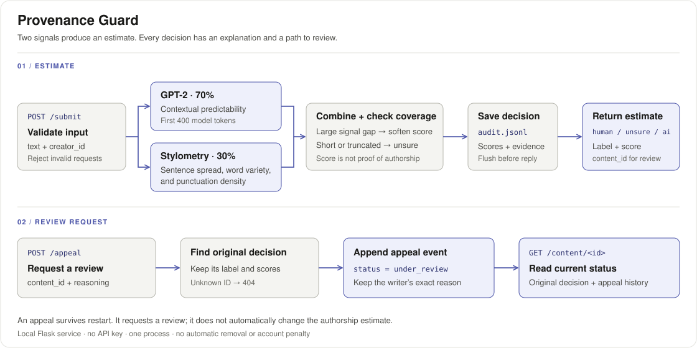

# Provenance Guard

A local API for estimating how a piece of writing was produced, explaining the estimate, and letting the writer appeal it. CodePath AI201 · Unit 7.



## What This Does

A writing site sends text and a creator ID to `POST /submit`. The service validates the request, runs GPT-2 and a separate style check, combines their scores, and returns `human`, `ai`, or `unsure` with a plain-English explanation. It saves the decision before replying.

If the writer disagrees, `POST /appeal` records their reason and changes the current status to `under_review`. The original label and scores stay intact. Restarting the service keeps both the decision and the appeal.

I think a wrong accusation costs more than a missed detection. That is why the unsure band is wide and even an AI estimate offers a review path. A score of 0.86 produces the AI label below; it does not remove the post or penalize the writer.

### Run locally

Python 3.12. No API key. The first model download is about 550 MB.

```bash
python3.12 -m venv .venv
source .venv/bin/activate
python -m pip install -r requirements.lock
PORT=5057 python app.py
```

[RUNNING.md](RUNNING.md) covers setup and troubleshooting. The [five acceptance criteria](criteria.md) and scoring design were committed before implementation and model results in `9d6261c`.

| Endpoint | Purpose |
|---|---|
| `POST /submit` | Accept `text` and `creator_id`; return a content ID, estimate, score, label, and both signals. |
| `POST /appeal` | Accept `content_id` and `reasoning`; save the appeal and return `under_review`. |
| `GET /content/<id>` | Return the original decision, current status, and appeals. Declared before implementation as the stretch feature. |
| `GET /log` | Read recorded events; `?limit=2` returns the latest two, in order. |
| `GET /health` | Check model and storage state. `/ping` remains the starter control route. |

This is a local prototype: one process, a JSONL log, and no authentication or completed-review workflow. Creator IDs are supplied by the caller. Rate limiting and the held-out evaluation belong to Unit 8.

## Signals and Scoring

| Signal | What it measures | What it misses |
|---|---|---|
| GPT-2 — `detector.py::signal_details` | How predictable the next tokens are, using the first 400 tokens. Lower perplexity gives a higher AI score. | Plain human writing can be predictable; unusual AI writing can be surprising. |
| Style — `stylometry.py::style_details` | Sentence-length variation, vocabulary variety in 50-word windows, and punctuation per word. | Editing surface form can change the score without changing who wrote the text. |

The combining rule is in `scoring.py::combine_signals`; weights and thresholds are in `config.py`:

```text
score = 0.70 × model_score + 0.30 × style_score
If |model_score − style_score| > 0.50: score = 0.5 + 0.5 × (score − 0.5)
If evidence is incomplete:           score = 0.5 + 0.25 × (score − 0.5)
```

Incomplete means fewer than 40 words, fewer than three sentences, or more than 400 model tokens. These inputs always land in `unsure`. The response states which limit applied. `confidence` and `combined_score` contain the same AI-likeness score; it is not a calibrated probability of authorship.

<details>
<summary>Exact signal formulas</summary>

- **Model:** `1 / (1 + exp(1.6 × (log(perplexity) − log(45))))`, using a bounded exponential. This retains the starter's midpoint and slope.
- **Style:** `0.55 × uniformity + 0.30 × repetition + 0.15 × sparse_punctuation`.
- `uniformity = max(0, 1 − sentence_length_CV)`; CV is population standard deviation divided by the mean word count.
- `repetition = clip((0.9 − windowed_TTR) / 0.5, 0, 1)`; windowed TTR is a length-weighted mean over consecutive 50-word windows.
- `sparse_punctuation = max(0, 1 − punctuation_per_word / 0.3)`; punctuation uses Unicode character categories.
- Style returns a neutral `0.5` below 40 words or three sentences. Signal scores use four decimals; the final score uses six.

</details>

## Label Variants

These are the exact strings returned by `scoring.py::score_to_label`.

| Score | Estimate | Reader-facing label |
|---|---|---|
| `0 ≤ score ≤ 0.25` | `human` | This writing shows patterns often found in human writing. This automated estimate does not verify who wrote it. You can request a review if it seems wrong. |
| `0.25 < score < 0.80` | `unsure` | We cannot reliably tell how this writing was produced. No conclusion about authorship has been made. You can request a review. |
| `0.80 ≤ score ≤ 1` | `ai` | This writing shows patterns often found in AI-generated text. This is an automated estimate, not proof of authorship. If this seems wrong, you can request a review. |

## Sample Run

### What the real model returned

Nine fixed examples and one repeat, using local GPT-2 on CPU. The examples include generated text, edited AI text, and attributed human excerpts. [Fixture text and sources](fixtures/development.json) · [Complete HTTP run](results/unit7_final_verification.json).

| Example | Model | Style | Combined | Estimate |
|---|---:|---:|---:|---|
| AI paragraph | 0.7607 | 0.6230 | 0.719390 | `unsure` |
| Repetitive AI control | 0.9951 | 0.9545 | 0.982920 | `ai` |
| Lightly edited AI | 0.6943 | 0.3756 | 0.598690 | `unsure` |
| Human narrative — Carroll | 0.7279 | 0.6236 | 0.696610 | `unsure` |
| Formal human prose — Darwin | 0.5671 | 0.4552 | 0.533530 | `unsure` |
| Human poem — Carroll | 0.1806 | 0.5328 | 0.286260 | `unsure` |
| Short AI fragment | 0.2879 | 0.5000 | 0.462882 | `unsure` |
| AI text beyond 400 tokens | 0.9970 | 0.9500 | 0.620725 | `unsure` |
| Ornate AI prose | 0.1643 | 0.0663 | 0.134900 | `human` |
| AI paragraph — repeat | 0.7607 | 0.6230 | 0.719390 | `unsure` |

**What it gets wrong:** the ornate AI passage received `human` at **0.1349**. Rare wording reduced the GPT-2 score, and varied sentences reduced the style score. Both signals failed in the same direction. All three real human excerpts returned `unsure`. Reaching three labels proves the paths work; it does not prove the detector is accurate.

The edited AI passage shows a smaller disagreement: model **0.6943**, style **0.3756**. The gap is below 0.50, so the extra disagreement adjustment does not apply. The short and truncated examples both return `unsure`, as intended.

**Measured timing:** first request **2.8177 s**, including loading the cached model; subsequent requests **0.0175–0.1262 s**. Recorded October 21, 2026 on macOS arm64, Python 3.12.13, torch 2.14.1, and GPT-2 revision `607a30d`. This excludes the initial download and is not a throughput benchmark.

### Submission → appeal → current status

The example below returned **201** for submission and **200** for both the appeal and lookup. The saved content ID is `c0298b94-20ce-4793-ade0-4e8505f9a433`. On a new run, replace it with the ID returned by that run.

<details>
<summary>1. Submit — full request and response</summary>

Request body (`fixtures/sample_submit.json`):

```json
{
  "text": "A reliable service should be simple to use and easy to understand. It should accept a request and return a clear response. It should record important decisions so that people can review them later. When a mistake occurs, the service should explain what happened and offer a way to request help. These basic steps can improve trust and make the service more useful for everyone.",
  "creator_id": "demo_writer"
}
```

```bash
curl http://127.0.0.1:5057/submit \
  -H 'Content-Type: application/json' \
  --data-binary @fixtures/sample_submit.json
```

HTTP **201**, complete recorded response:

```json
{
  "combined_score": 0.71939,
  "confidence": 0.71939,
  "confidence_kind": "uncalibrated_ai_likeness",
  "content_id": "c0298b94-20ce-4793-ade0-4e8505f9a433",
  "evidence": {
    "limitations": [],
    "model": {
      "device": "cpu",
      "model": "gpt2",
      "model_revision": "607a30d783dfa663caf39e06633721c8d4cfcd7e",
      "model_score": 0.7607,
      "perplexity": 21.84343051144389,
      "tokens_scored": 71,
      "tokens_total": 71,
      "truncated": false
    },
    "signals_disagree": false,
    "style": {
      "components": {
        "repetition": 0.230769,
        "sparse_punctuation": 0.692308,
        "uniformity": 0.817967
      },
      "punctuation_density": 0.092308,
      "sentence_count": 5,
      "sentence_length_spread": 0.182033,
      "style_score": 0.623,
      "sufficient_evidence": true,
      "type_token_ratio": 0.723077,
      "windowed_type_token_ratio": 0.784615,
      "word_count": 65
    }
  },
  "guess": "unsure",
  "label": "We cannot reliably tell how this writing was produced. No conclusion about authorship has been made. You can request a review.",
  "model_score": 0.7607,
  "review_available": true,
  "scoring_version": "unit7-v1",
  "status": "decided",
  "style_score": 0.623
}
```

</details>

<details>
<summary>2. Appeal — full request and response</summary>

Request body (`fixtures/sample_appeal.json`):

```json
{
  "content_id": "c0298b94-20ce-4793-ade0-4e8505f9a433",
  "reasoning": "Please review this estimate. This is a development appeal; it is not an admission about authorship."
}
```

```bash
curl http://127.0.0.1:5057/appeal \
  -H 'Content-Type: application/json' \
  --data-binary @fixtures/sample_appeal.json
```

HTTP **200**, complete recorded response:

```json
{
  "content_id": "c0298b94-20ce-4793-ade0-4e8505f9a433",
  "message": "Your review request has been recorded. The original estimate is preserved; no automatic reclassification has been made.",
  "status": "under_review"
}
```

</details>

<details>
<summary>3. Audit — original decision and appended appeal</summary>

```bash
curl 'http://127.0.0.1:5057/log?limit=2'
```

The response contains the following two events. These are the exact appended lines from [logs/audit.jsonl](logs/audit.jsonl); the full HTTP response is in [results/sample_log.json](results/sample_log.json).

```jsonl
{"timestamp": "2026-10-21T22:36:17+00:00", "content_id": "c0298b94-20ce-4793-ade0-4e8505f9a433", "creator_id": "demo_writer", "guess": "unsure", "model_score": 0.7607, "style_score": 0.623, "combined_score": 0.71939, "label": "We cannot reliably tell how this writing was produced. No conclusion about authorship has been made. You can request a review.", "status": "decided", "event": "decision", "confidence": 0.71939, "confidence_kind": "uncalibrated_ai_likeness", "scoring_version": "unit7-v1", "evidence": {"model": {"perplexity": 21.84343051144389, "tokens_total": 71, "tokens_scored": 71, "truncated": false, "model": "gpt2", "model_revision": "607a30d783dfa663caf39e06633721c8d4cfcd7e", "device": "cpu", "model_score": 0.7607}, "style": {"style_score": 0.623, "word_count": 65, "sentence_count": 5, "sufficient_evidence": true, "sentence_length_spread": 0.182033, "type_token_ratio": 0.723077, "windowed_type_token_ratio": 0.784615, "punctuation_density": 0.092308, "components": {"uniformity": 0.817967, "repetition": 0.230769, "sparse_punctuation": 0.692308}}, "limitations": [], "signals_disagree": false}, "text_sha256": "ceb68967430286c52a252c49f5a9e367e9184d19133b68da4bd49dd759191f5d", "text_length": 377}
{"guess": "unsure", "model_score": 0.7607, "style_score": 0.623, "combined_score": 0.71939, "label": "We cannot reliably tell how this writing was produced. No conclusion about authorship has been made. You can request a review.", "timestamp": "2026-10-21T22:36:26+00:00", "content_id": "c0298b94-20ce-4793-ade0-4e8505f9a433", "creator_id": "demo_writer", "event": "appeal", "status": "under_review", "reasoning": "Please review this estimate. This is a development appeal; it is not an admission about authorship."}
```

</details>

<details>
<summary>4. Content lookup — complete stretch-feature response</summary>

```bash
curl http://127.0.0.1:5057/content/c0298b94-20ce-4793-ade0-4e8505f9a433
```

HTTP **200**. Current status is `under_review`; the original decision still has `status=decided`.

```json
{
  "appeals": [
    {
      "combined_score": 0.71939,
      "content_id": "c0298b94-20ce-4793-ade0-4e8505f9a433",
      "creator_id": "demo_writer",
      "event": "appeal",
      "guess": "unsure",
      "label": "We cannot reliably tell how this writing was produced. No conclusion about authorship has been made. You can request a review.",
      "model_score": 0.7607,
      "reasoning": "Please review this estimate. This is a development appeal; it is not an admission about authorship.",
      "status": "under_review",
      "style_score": 0.623,
      "timestamp": "2026-10-21T22:36:26+00:00"
    }
  ],
  "content_id": "c0298b94-20ce-4793-ade0-4e8505f9a433",
  "original_decision": {
    "combined_score": 0.71939,
    "confidence": 0.71939,
    "confidence_kind": "uncalibrated_ai_likeness",
    "content_id": "c0298b94-20ce-4793-ade0-4e8505f9a433",
    "creator_id": "demo_writer",
    "event": "decision",
    "evidence": {
      "limitations": [],
      "model": {
        "device": "cpu",
        "model": "gpt2",
        "model_revision": "607a30d783dfa663caf39e06633721c8d4cfcd7e",
        "model_score": 0.7607,
        "perplexity": 21.84343051144389,
        "tokens_scored": 71,
        "tokens_total": 71,
        "truncated": false
      },
      "signals_disagree": false,
      "style": {
        "components": {
          "repetition": 0.230769,
          "sparse_punctuation": 0.692308,
          "uniformity": 0.817967
        },
        "punctuation_density": 0.092308,
        "sentence_count": 5,
        "sentence_length_spread": 0.182033,
        "style_score": 0.623,
        "sufficient_evidence": true,
        "type_token_ratio": 0.723077,
        "windowed_type_token_ratio": 0.784615,
        "word_count": 65
      }
    },
    "guess": "unsure",
    "label": "We cannot reliably tell how this writing was produced. No conclusion about authorship has been made. You can request a review.",
    "model_score": 0.7607,
    "scoring_version": "unit7-v1",
    "status": "decided",
    "style_score": 0.623,
    "text_length": 377,
    "text_sha256": "ceb68967430286c52a252c49f5a9e367e9184d19133b68da4bd49dd759191f5d",
    "timestamp": "2026-10-21T22:36:17+00:00"
  },
  "status": "under_review"
}
```

</details>

### Checks and remaining limits

- **17 unit tests pass:** validation before inference, exact label boundaries, a 1,001-point score grid, concurrent audit appends, and model/storage failures. [Test output](results/unit_tests.txt).
- **10/10 appeals survive restart:** a fresh service process returns every original decision and exact appeal reason unchanged. This check uses real model calls over HTTP, separately from the unit-test doubles. [Run evidence](results/unit7_final_verification.json).
- **Nine setup checks pass.** [Environment output](results/environment_check.txt).
- **Criteria 1 and 2 are not measured yet:** false-positive rate and median score separation need the separate held-out corpus and three trials in Unit 8. The development examples do not substitute for that corpus. Familiar literature may also overlap GPT-2's training data.

To reproduce:

```bash
python -m unittest discover -s tests -v
python test.py
python scripts/verify_unit7.py --output results/my_verification.json
```

The real-model script needs the model cached first. It appends audit events, restarts its own server, and refuses to overwrite an existing results file.

## How I Used AI

1. **Request flow.** I used Codex to work through the API design and draft the acceptance criteria before running examples. It proposed explicit uncertainty checks and a separate appeal event. Those choices are in the implementation: short or partly examined text stays `unsure`, and an appeal keeps the original decision intact.
2. **Finding failure paths.** During implementation, AI-assisted review found an unreadable-log case and a possible overflow in the score calculation. The fixes return `503` for damaged history and bound the exponential calculation; the tests and real-model run were repeated afterward. I think the more important finding is still the ornate AI false negative above. Changing thresholds just to hide that example would not fix what either signal measures.
