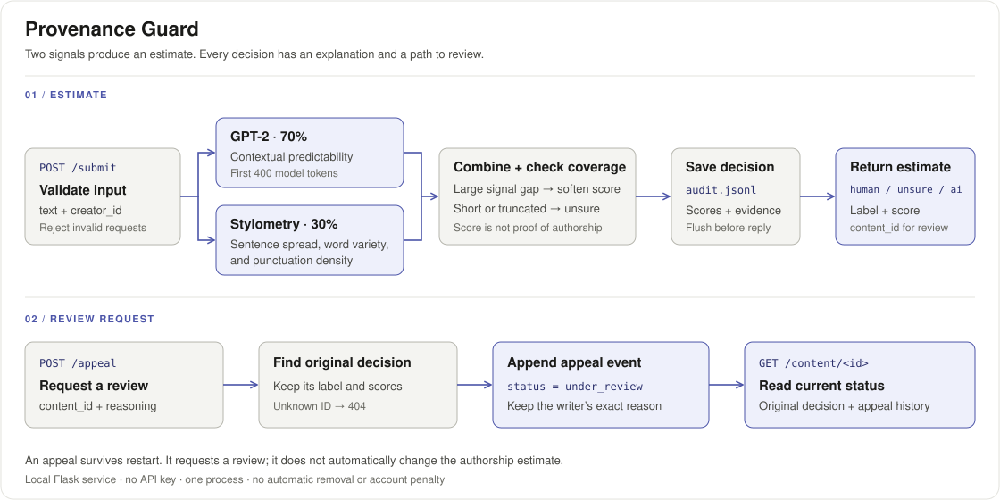

# Provenance Guard

A local API for estimating how a piece of writing was produced, explaining the estimate, and letting the writer appeal it. CodePath AI201 · Unit 7.



## What This Does

A writing site sends text and a creator ID to `POST /submit`. The service validates the request, runs GPT-2 and a separate style check, combines their scores, and returns `human`, `ai`, or `unsure` with a plain-English explanation. It saves the decision before replying.

If the writer disagrees, `POST /appeal` records their reason and changes the current status to `under_review`. The original label and scores stay intact. Restarting the service keeps both the decision and the appeal.

I think a wrong accusation costs more than a missed detection. That is why the unsure band is wide and even an AI estimate offers a review path. A score of 0.86 produces the AI label below; it does not remove the post or penalize the writer.

### Run locally

Python 3.12. No API key. The first model download is about 550 MB.

```bash
python3.12 -m venv .venv
source .venv/bin/activate
python -m pip install -r requirements.lock
PORT=5057 python app.py
```

[RUNNING.md](RUNNING.md) covers setup and troubleshooting. The [five acceptance criteria](criteria.md) and scoring design were committed before implementation and model results in `9d6261c`.

| Endpoint | Purpose |
|---|---|
| `POST /submit` | Accept `text` and `creator_id`; return a content ID, estimate, score, label, and both signals. |
| `POST /appeal` | Accept `content_id` and `reasoning`; save the appeal and return `under_review`. |
| `GET /content/<id>` | Return the original decision, current status, and appeals. Declared before implementation as the stretch feature. |
| `GET /log` | Read recorded events; `?limit=2` returns the latest two, in order. |
| `GET /health` | Check model and storage state. `/ping` remains the starter control route. |

This is a local prototype: one process, a JSONL log, and no authentication or completed-review workflow. Creator IDs are supplied by the caller. Rate limiting and the held-out evaluation belong to Unit 8.

## Signals and Scoring

| Signal | What it measures | What it misses |
|---|---|---|
| GPT-2 — `detector.py::signal_details` | How predictable the next tokens are, using the first 400 tokens. Lower perplexity gives a higher AI score. | Plain human writing can be predictable; unusual AI writing can be surprising. |
| Style — `stylometry.py::style_details` | Sentence-length variation, vocabulary variety in 50-word windows, and punctuation per word. | Editing surface form can change the score without changing who wrote the text. |

The combining rule is in `scoring.py::combine_signals`, with the evidence adjustment in `scoring.py::decision_score`. Weights and thresholds are in `config.py`:

```text
score = 0.70 × model_score + 0.30 × style_score
If |model_score − style_score| > 0.50: score = 0.5 + 0.5 × (score − 0.5)
If evidence is incomplete:           score = 0.5 + 0.25 × (score − 0.5)
```

Incomplete means fewer than 40 words, fewer than three sentences, or more than 400 model tokens. These inputs always land in `unsure`. The response states which limit applied. `confidence` and `combined_score` contain the same AI-likeness score; it is not a calibrated probability of authorship.

<details>
<summary>Exact signal formulas</summary>

- **Model:** `1 / (1 + exp(1.6 × (log(perplexity) − log(45))))`, using a bounded exponential. This retains the starter's midpoint and slope.
- **Style:** `0.55 × uniformity + 0.30 × repetition + 0.15 × sparse_punctuation`.
- `uniformity = max(0, 1 − sentence_length_CV)`; CV is population standard deviation divided by the mean word count.
- `repetition = clip((0.9 − windowed_TTR) / 0.5, 0, 1)`; windowed TTR is a length-weighted mean over consecutive 50-word windows.
- `sparse_punctuation = max(0, 1 − punctuation_per_word / 0.3)`; punctuation uses Unicode character categories.
- Style returns a neutral `0.5` below 40 words or three sentences. Signal scores use four decimals; the final score uses six.

</details>

## Label Variants

These are the exact strings returned by `scoring.py::score_to_label`.

| Score | Estimate | Reader-facing label |
|---|---|---|
| `0 ≤ score ≤ 0.25` | `human` | This writing shows patterns often found in human writing. This automated estimate does not verify who wrote it. You can request a review if it seems wrong. |
| `0.25 < score < 0.80` | `unsure` | We cannot reliably tell how this writing was produced. No conclusion about authorship has been made. You can request a review. |
| `0.80 ≤ score ≤ 1` | `ai` | This writing shows patterns often found in AI-generated text. This is an automated estimate, not proof of authorship. If this seems wrong, you can request a review. |

## Sample Run

### What the real model returned

Nine fixed examples and one repeat, using local GPT-2 on CPU. The examples include generated text, edited AI text, and attributed human excerpts. [Fixture text and sources](fixtures/development.json) · [Complete HTTP run](results/unit7_rubric_review.json).

| Example | Model | Style | Combined | Estimate |
|---|---:|---:|---:|---|
| AI paragraph | 0.7607 | 0.6230 | 0.719390 | `unsure` |
| Repetitive AI control | 0.9951 | 0.9545 | 0.982920 | `ai` |
| Lightly edited AI | 0.6943 | 0.3756 | 0.598690 | `unsure` |
| Human narrative — Carroll | 0.7279 | 0.6236 | 0.696610 | `unsure` |
| Formal human prose — Darwin | 0.5671 | 0.4552 | 0.533530 | `unsure` |
| Human poem — Carroll | 0.1806 | 0.5328 | 0.286260 | `unsure` |
| Short AI fragment | 0.2879 | 0.5000 | 0.462882 | `unsure` |
| AI text beyond 400 tokens | 0.9970 | 0.9500 | 0.620725 | `unsure` |
| Ornate AI prose | 0.1643 | 0.0663 | 0.134900 | `human` |
| AI paragraph — repeat | 0.7607 | 0.6230 | 0.719390 | `unsure` |

**What it gets wrong:** the ornate AI passage received `human` at **0.1349**. High perplexity produced a low GPT-2 score; the style score was also low. Both signals failed in the same direction. All three real human excerpts returned `unsure`. Reaching three labels proves the paths work; it does not prove the detector is accurate.

The edited AI passage shows a smaller disagreement: model **0.6943**, style **0.3756**. The gap is below 0.50, so the extra disagreement adjustment does not apply. The short and truncated examples both return `unsure`, as intended.

**Measured request latency:** first request **2.40 seconds**, including loading the cached model; subsequent requests **16–128 milliseconds**. Recorded October 21, 2026 on macOS arm64, Python 3.12.13, torch 2.14.1, and GPT-2 revision `607a30d`. This excludes the initial download and is not a throughput benchmark.

### Submission → appeal → current status

The example below returned **201** for submission and **200** for both the appeal and lookup. The saved content ID is `c0298b94-20ce-4793-ade0-4e8505f9a433`. On a new run, replace it with the ID returned by that run.

<details>
<summary>1. Submit — full request and response</summary>

Request body (`fixtures/sample_submit.json`):

```json
{
  "text": "A reliable service should be simple to use and easy to understand. It should accept a request and return a clear response. It should record important decisions so that people can review them later. When a mistake occurs, the service should explain what happened and offer a way to request help. These basic steps can improve trust and make the service more useful for everyone.",
  "creator_id": "demo_writer"
}
```

```bash
curl http://127.0.0.1:5057/submit \
  -H 'Content-Type: application/json' \
  --data-binary @fixtures/sample_submit.json
```

HTTP **201**, complete recorded response:

```json
{
  "combined_score": 0.71939,
  "confidence": 0.71939,
  "confidence_kind": "uncalibrated_ai_likeness",
  "content_id": "c0298b94-20ce-4793-ade0-4e8505f9a433",
  "evidence": {
    "limitations": [],
    "model": {
      "device": "cpu",
      "model": "gpt2",
      "model_revision": "607a30d783dfa663caf39e06633721c8d4cfcd7e",
      "model_score": 0.7607,
      "perplexity": 21.84343051144389,
      "tokens_scored": 71,
      "tokens_total": 71,
      "truncated": false
    },
    "signals_disagree": false,
    "style": {
      "components": {
        "repetition": 0.230769,
        "sparse_punctuation": 0.692308,
        "uniformity": 0.817967
      },
      "punctuation_density": 0.092308,
      "sentence_count": 5,
      "sentence_length_spread": 0.182033,
      "style_score": 0.623,
      "sufficient_evidence": true,
      "type_token_ratio": 0.723077,
      "windowed_type_token_ratio": 0.784615,
      "word_count": 65
    }
  },
  "guess": "unsure",
  "label": "We cannot reliably tell how this writing was produced. No conclusion about authorship has been made. You can request a review.",
  "model_score": 0.7607,
  "review_available": true,
  "scoring_version": "unit7-v1",
  "status": "decided",
  "style_score": 0.623
}
```

</details>

<details>
<summary>2. Appeal — full request and response</summary>

Request body (`fixtures/sample_appeal.json`):

```json
{
  "content_id": "c0298b94-20ce-4793-ade0-4e8505f9a433",
  "reasoning": "Please review this estimate. This is a development appeal; it is not an admission about authorship."
}
```

```bash
curl http://127.0.0.1:5057/appeal \
  -H 'Content-Type: application/json' \
  --data-binary @fixtures/sample_appeal.json
```

HTTP **200**, complete recorded response:

```json
{
  "content_id": "c0298b94-20ce-4793-ade0-4e8505f9a433",
  "message": "Your review request has been recorded. The original estimate is preserved; no automatic reclassification has been made.",
  "status": "under_review"
}
```

</details>

<details>
<summary>3. Audit — original decision and appended appeal</summary>

```bash
curl 'http://127.0.0.1:5057/log?limit=2'
```

The response contains the following two events. These are the exact appended lines from [logs/audit.jsonl](logs/audit.jsonl); the full HTTP response is in [results/sample_log.json](results/sample_log.json).

```jsonl
{"timestamp": "2026-10-21T22:36:17+00:00", "content_id": "c0298b94-20ce-4793-ade0-4e8505f9a433", "creator_id": "demo_writer", "guess": "unsure", "model_score": 0.7607, "style_score": 0.623, "combined_score": 0.71939, "label": "We cannot reliably tell how this writing was produced. No conclusion about authorship has been made. You can request a review.", "status": "decided", "event": "decision", "confidence": 0.71939, "confidence_kind": "uncalibrated_ai_likeness", "scoring_version": "unit7-v1", "evidence": {"model": {"perplexity": 21.84343051144389, "tokens_total": 71, "tokens_scored": 71, "truncated": false, "model": "gpt2", "model_revision": "607a30d783dfa663caf39e06633721c8d4cfcd7e", "device": "cpu", "model_score": 0.7607}, "style": {"style_score": 0.623, "word_count": 65, "sentence_count": 5, "sufficient_evidence": true, "sentence_length_spread": 0.182033, "type_token_ratio": 0.723077, "windowed_type_token_ratio": 0.784615, "punctuation_density": 0.092308, "components": {"uniformity": 0.817967, "repetition": 0.230769, "sparse_punctuation": 0.692308}}, "limitations": [], "signals_disagree": false}, "text_sha256": "ceb68967430286c52a252c49f5a9e367e9184d19133b68da4bd49dd759191f5d", "text_length": 377}
{"guess": "unsure", "model_score": 0.7607, "style_score": 0.623, "combined_score": 0.71939, "label": "We cannot reliably tell how this writing was produced. No conclusion about authorship has been made. You can request a review.", "timestamp": "2026-10-21T22:36:26+00:00", "content_id": "c0298b94-20ce-4793-ade0-4e8505f9a433", "creator_id": "demo_writer", "event": "appeal", "status": "under_review", "reasoning": "Please review this estimate. This is a development appeal; it is not an admission about authorship."}
```

</details>

<details>
<summary>4. Content lookup — complete stretch-feature response</summary>

```bash
curl http://127.0.0.1:5057/content/c0298b94-20ce-4793-ade0-4e8505f9a433
```

HTTP **200**. Current status is `under_review`; the original decision still has `status=decided`.

```json
{
  "appeals": [
    {
      "combined_score": 0.71939,
      "content_id": "c0298b94-20ce-4793-ade0-4e8505f9a433",
      "creator_id": "demo_writer",
      "event": "appeal",
      "guess": "unsure",
      "label": "We cannot reliably tell how this writing was produced. No conclusion about authorship has been made. You can request a review.",
      "model_score": 0.7607,
      "reasoning": "Please review this estimate. This is a development appeal; it is not an admission about authorship.",
      "status": "under_review",
      "style_score": 0.623,
      "timestamp": "2026-10-21T22:36:26+00:00"
    }
  ],
  "content_id": "c0298b94-20ce-4793-ade0-4e8505f9a433",
  "original_decision": {
    "combined_score": 0.71939,
    "confidence": 0.71939,
    "confidence_kind": "uncalibrated_ai_likeness",
    "content_id": "c0298b94-20ce-4793-ade0-4e8505f9a433",
    "creator_id": "demo_writer",
    "event": "decision",
    "evidence": {
      "limitations": [],
      "model": {
        "device": "cpu",
        "model": "gpt2",
        "model_revision": "607a30d783dfa663caf39e06633721c8d4cfcd7e",
        "model_score": 0.7607,
        "perplexity": 21.84343051144389,
        "tokens_scored": 71,
        "tokens_total": 71,
        "truncated": false
      },
      "signals_disagree": false,
      "style": {
        "components": {
          "repetition": 0.230769,
          "sparse_punctuation": 0.692308,
          "uniformity": 0.817967
        },
        "punctuation_density": 0.092308,
        "sentence_count": 5,
        "sentence_length_spread": 0.182033,
        "style_score": 0.623,
        "sufficient_evidence": true,
        "type_token_ratio": 0.723077,
        "windowed_type_token_ratio": 0.784615,
        "word_count": 65
      }
    },
    "guess": "unsure",
    "label": "We cannot reliably tell how this writing was produced. No conclusion about authorship has been made. You can request a review.",
    "model_score": 0.7607,
    "scoring_version": "unit7-v1",
    "status": "decided",
    "style_score": 0.623,
    "text_length": 377,
    "text_sha256": "ceb68967430286c52a252c49f5a9e367e9184d19133b68da4bd49dd759191f5d",
    "timestamp": "2026-10-21T22:36:17+00:00"
  },
  "status": "under_review"
}
```

</details>

### Checks and remaining limits

- **21 unit tests pass:** validation before inference, exact label boundaries, a 1,001-point score grid, concurrent appends, Unicode appeal text, missing final newlines, and model/storage failures. [Test output](results/unit_tests_rubric_review.txt).
- **10/10 appeals survive restart:** a fresh service process returns every original decision and exact appeal reason unchanged. This check uses real model calls over HTTP, separately from the unit-test doubles. [Run evidence](results/unit7_rubric_review.json).
- **Nine setup checks pass.** [Environment output](results/environment_rubric_review.txt).
- **Criteria 1 and 2 are not measured yet:** false-positive rate and median score separation need the separate held-out corpus and three trials in Unit 8. The development examples do not substitute for that corpus. Familiar literature may also overlap GPT-2's training data.

To reproduce:

```bash
python -m unittest discover -s tests -v
python test.py
python scripts/verify_unit7.py --output results/my_verification.json
```

The real-model script needs the model cached first. It appends audit events, restarts its own server, and refuses to overwrite an existing results file.

## How I Used AI

I defined the criteria and expected behavior, checked the outputs at each step, and proposed solutions when something did not match. Codex helped with implementation and identified edge cases I had missed.

1. **Uncertain inputs.** I used AI to check where the signals could overstate confidence. It identified short passages and text beyond the model's token limit. I chose explicit `unsure` results with an explanation of the missing evidence; those checks now run before a label is returned.
2. **Failure handling.** I used AI to review whether appeals could appear successful without usable history. It found unreadable-log cases and Unicode separators that broke later lookups. The required behavior was to preserve the exact appeal reason and original decision, and return `503` when storage was unusable. Regression tests and the restart check verify those changes.

I think the ornate AI false negative is the clearest remaining limitation. I kept it in the results and left the thresholds unchanged.

## Rate Limiting

The service allows 6 requests per minute and 120 per day for one creator ID. A writer can make several normal submissions. A script cannot make unlimited quick requests.

The key is the creator ID, not only the network address. This is the extra safety check in the limiter. One script cannot avoid the limit by using many addresses while keeping the same creator ID.

The local flood test sent 15 requests as `unit8_flood`. The first 6 returned `201`. The next 9 returned `429`.

```text
201 201 201 201 201 201 429 429 429 429 429 429 429 429 429
```

The complete run is in `results/flood_2026-11-04_1852.md`. The audit log includes each accepted decision and each rate limit rejection.

## Attack Run Before

The official set was run from `/Users/viksmacpro/Downloads/attack_set`. It contained 56 requests and caused no server crashes. The complete report is `results/attack_run_2026-11-04_2118_before.md`.

## Run Log and Verdicts

The official before and after reports, each attack verdict, ten audit events, and the route diagnosis are in `results/attack_review_2026-11-04.md`.

The Unit 7 verification covers route validation, label boundaries, storage failures, durable appeals, and restart recovery.

## Held Out Evaluation

The frozen set has 20 sourced human passages and 20 topic matched AI passages. The set passes its structure check before any score is recorded.

```bash
.venv/bin/python scripts/validate_held_out.py evaluation/held_out.jsonl
PORT=5064 .venv/bin/python app.py
.venv/bin/python scripts/run_held_out_evaluation.py --url http://127.0.0.1:5064 --trials 3 --label source_corrected
```

The live three trial result is in `results/held_out_evaluation_2026-11-08_1924_source_corrected.md`.

Criterion 1 passed in all three trials. All 20 human passages were accepted in each trial and none was labelled AI.

Criterion 2 was not met in any trial. The human median was `0.461710`, the AI median was `0.318185`, and the difference was `-0.143525`. The target requires a positive difference of at least `0.20`. The threshold and weights were not changed after seeing this result.

### Criterion 2 Diagnosis

This failure happened before label mapping. The model signal median was `0.378700` for the human set and `0.279600` for the AI set. The style signal median was `0.500000` for the human set and `0.458100` for the AI set. The combining rule uses 70 percent model signal and 30 percent style signal, so it preserved the same direction and produced the lower AI combined median.

The style mechanism is visible in the frozen data. The human passages had a median of 2.5 sentences, so many used the neutral `0.5` weak evidence fallback. The AI passages had a median of 5 sentences but a higher median windowed vocabulary ratio, `0.865537` compared with `0.816698`, which reduced the style score's repetition component. The model signal also ranked the two groups in the wrong direction. A plausible reason is that the public domain human texts are familiar or predictable to GPT 2, but this run does not prove that cause.

The label mapping did not create this failure because criterion 2 compares scores, not labels. I did not change the frozen weights, threshold, corpus text, or label mapping after measuring the result. A later project could test a corpus from sources outside the model's training data and replace the surface style heuristic with a separately validated signal.

## Improvement

The measured improvement came from MF03 in the official attack set. Before the change, invisible control characters were accepted and scored. The route now rejects unsupported control characters with a `400` response. The exact before and after result is recorded in `results/attack_review_2026-11-04.md`.

## What Is Still Broken

This service does not prove authorship. Style changes, editing, language background, topic, and unusual vocabulary can move both scores. The held out evaluation also shows that this scoring design did not separate this AI set from this human set. The in memory limiter resets when the service restarts and does not coordinate across multiple service processes. The appeal route records a review request but does not finish a human review.

The repository includes `evaluation/README.md`, `scripts/validate_held_out.py`, and `scripts/run_held_out_evaluation.py`. The validator checks count, text length, source fields, verification, duplicate text, and topic coverage. The runner sends every frozen passage in three trials, records every response, and calculates the two required measurements.

## Capstone

**What This Extends**

I am extending Provenance Guard, the local writing estimate and appeal service from Units 7 and 8. The new work is an operational record of every HTTP request, including requests the service rejects, with a request ID and measured duration. This is separate from the existing audit log, which records decisions and appeals as product evidence.

**The Shape**

Shape A: deploy and instrument, using the local-with-logs path. The extension is a reproducible start command and a structured JSONL request log that lets me inspect inputs, outcomes, errors, and timing after a run. I am keeping the service on loopback because its local GPT-2 model needs more memory than the course's free host provides. I am leaving detector scores and thresholds, the appeal workflow, and the in-memory rate limiter out of scope. I will not use real private writing in the capstone runs.

**Running It**

Path B, local with logs. [RUNNING.md](RUNNING.md) gives the Python 3.11.15 setup, pinned dependencies, model cache requirement, and single start command. The service listens on loopback at port 5057. The capstone request log is `logs/requests.jsonl`.

**Instrumentation**

`app.py::start_request_record` assigns a request ID and starts a monotonic timer. `app.py::record_request` writes one JSON object when the response is ready, including rejected requests and model failures. `request_log.py::append` flushes each record to `logs/requests.jsonl`. Each record has a UTC `timestamp`, `request_id`, `input` (method, path, content type, body size), `output` (HTTP status, guess, content ID, error code), and `duration_ms`. The response carries the same ID in `X-Request-ID`, so a caller can find its record. Raw writing, appeal reasons, and query strings are excluded from this operational log.

I cloned this repository to a new directory, installed `requirements.lock` in a fresh Python 3.11 environment, and ran the 22 service tests successfully. The documented single start command served `/health` with HTTP 200 and wrote a matching structured request record. The sample run and failed-run records will appear below with the capstone evaluation evidence.

**Run Log and Verdicts**

Before the improvement, I ran [three separate trials](results/capstone_before/report.json) against a clean checkout. Each trial used a fresh service process and fresh log directory. The trial script is `scripts/run_capstone_trials.py`.

| Criterion | Target in each trial | Run 1 | Run 2 | Run 3 | Verdict |
|---|---|---|---|---|---|
| 1. Match successful responses to records | 10/10 | 10/10 | 10/10 | 10/10 | MET |
| 2. Keep three private markers out of request log | 3/3 records, 0 markers | 3/3, 0 | 3/3, 0 | 3/3, 0 | MET |
| 3. Record rejected requests without decisions | 5/5, 0 decisions | 5/5, 0 | 5/5, 0 | 5/5, 0 | MET |
| 4. Start in a clean checkout | health and log match | MET | MET | MET | MET |
| 5. Record model time within total time | 10/10 | 0/10 | 0/10 | 0/10 | MISSED |

Criterion 5 missed at the instrumentation stage. `app.py::record_request` timed the full request, but `app.py::submit` never timed `detector.signal_details`. The request log therefore had `duration_ms` on every submission and no `model_duration_ms` on any of the 30 warm submissions. This is a missing measurement, not evidence that inference took zero time. I will time that call and add the measured value to the same request record, leaving the detector and scoring rule unchanged.
